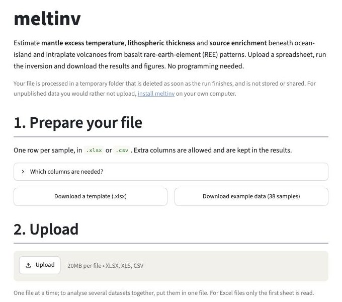
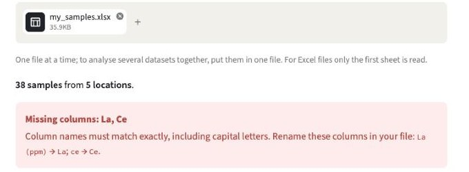
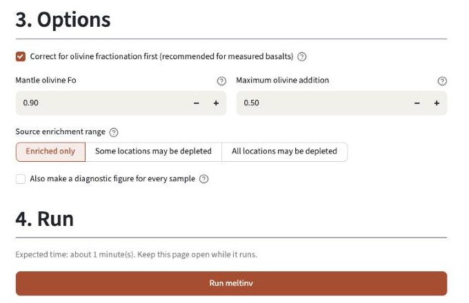
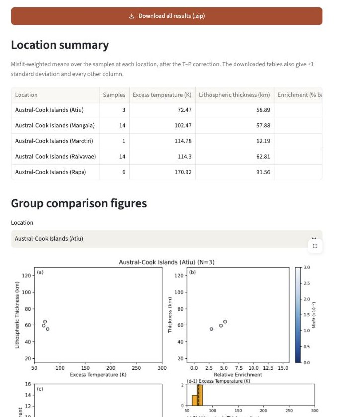

# Tutorial 1: The meltinv website

This tutorial runs a complete meltinv analysis **on the meltinv website, without any programming**. You will invert the bundled example file, **`examples.xlsx`**: 38 basalts from five Austral–Cook islands (Mangaia, Raivavae, Rapa, Atiu and Marotiri). It takes a few minutes.

<!-- TODO: replace this link with the Hugging Face Space address once the website is online -->
**Website:** https://huggingface.co/spaces/USER-NAME/meltinv

If the page says the app is starting, wait a minute or two: the free server sleeps when nobody has used it for two days. You can also [run the same website on your own computer](../app/README.md#run-it-on-your-own-computer).

[Tutorial 2](02_python_quick_start.ipynb) does the same analysis in Python, and [Tutorial 3](03_modern_OIB.ipynb) applies it to the full modern ocean-island basalt dataset from the paper.

## 1. Prepare your file

meltinv reads an `.xlsx` or `.csv` file with **one row per sample**. Click **Download example data (38 samples)** to get the file used in this tutorial, or **Download a template (.xlsx)** for an empty file with the right column names and one example row.

| Column | Needed for | Meaning |
|---|---|---|
| `location` | always | Samples with the same location are summarised and plotted together |
| `La` … `Lu` (14 REE) | always | Concentrations in ppm |
| `SiO2` … `P2O5` (10 major oxides) | the olivine correction | Major-element composition (wt%) of the measured basalt |
| `thickness` | optional | An independent estimate of lithospheric thickness (km), e.g. seismic, shown for comparison only |

- Column names must match exactly, including capital letters.
- Extra columns are allowed and are kept in the results.
- Blank cells, zeros, negative values and text such as `bdl` count as missing. Each sample needs **at least 6 usable REE**; samples with fewer are skipped.
- Upload **one file at a time**; for Excel files, only the first sheet is read. To analyse several datasets together, put them in one file.

## 2. Upload the file

Click **Upload** and choose `examples.xlsx`. The website reads the file straight away and reports how many samples and locations it found.

If something is wrong with the file, a red box says what, and how to fix it. Here, for example, two REE columns were named `La (ppm)` and `ce`:

The website also catches, among other things:

- column names that are not in the first row of the sheet;
- samples without a location (it gives their row numbers);
- numbers written with a decimal comma (`1,25`);
- REE cells containing text, and samples with fewer than 6 usable REE (a yellow note: the run can go ahead without them).

Fix the file in Excel and upload it again. Open **Preview the first rows** to check that the file was read as you expect.

## 3. Choose the options

- **Correct for olivine fractionation first.** The inversion compares your data with **primary-magma** compositions. Measured basalts have usually crystallised olivine, which raises their REE concentrations. With this option on, meltinv first adds olivine back to each sample (using meltPT) until the melt is in equilibrium with mantle olivine.
  - It is ticked automatically when the file has all 10 major-oxide columns. Leave it on for measured basalts, and switch it off if your file already contains primary-magma compositions.
  - **Mantle olivine Fo** (default 0.90) is the forsterite content of that mantle olivine; **Maximum olivine addition** (default 0.50) is the largest mass fraction of olivine that may be added.
  - Samples that cannot be corrected (usually olivine-rich, cumulate samples) are skipped rather than inverted with uncorrected compositions.
- **Source enrichment range.** By default the mantle source is primitive mantle mixed with **0–15% basalt**. If some locations may have a **depleted** source (for example Iceland), choose **Some locations may be depleted** and select them; their search then also includes mixtures of primitive and depleted mantle. For this tutorial, keep **Enriched only**.
- **Also make a diagnostic figure for every sample.** Adds one 4-panel figure per sample (section 6). It makes the run and the download larger, so it is off by default and available for files of up to 300 samples.

## 4. Run

Click **Run meltinv** and keep the page open. A progress line shows what meltinv is doing. For the example file the run takes about a minute, most of it for the olivine correction, which takes roughly a third of a second per sample. The inversion itself is much faster: about a minute for 1,000 samples.

## 5. Read the results

Click **Download all results (.zip)**. The zip file contains:

| File | Contents |
|---|---|
| `inversion_results/examples_sample_inversion_log10.xlsx` | One row per sample |
| `inversion_results/examples_sample_inversion_summary_log10.xlsx` | One row per location |
| `inversion_results/examples_corrected.xlsx` | The olivine-corrected compositions, and how much olivine was added (`ol_added`) |
| `inversion_figures/` | The figures (section 6) |
| `plot_archive.zip` | Everything needed to redraw the figures later in Python ([Tutorial 2](02_python_quick_start.ipynb), section 7) |
| `README.txt` | The settings you chose, any skipped samples, and how to cite meltinv |

The main columns of both results tables are:

| Column | Meaning |
|---|---|
| `T_mean_cali` | Mantle excess temperature (K) |
| `depth_mean_cali` | Lithospheric thickness (km) |
| `basalt_percentage` | Source enrichment: % of basalt mixed into primitive mantle (negative values: depleted mantle) |
| `misfit_value` | How well the best model fits the REE pattern; lower is better |
| `T_mean`, `depth_mean` | The temperature and thickness before the pyroxenite T–P correction |
| `litho_thickness_ref` | Your `thickness` column, if you supplied one |

`_cali` columns include a correction for the effect of pyroxenite (recycled basalt) in the source on where melting starts. The location summary averages each location's samples, weighting better-fitting samples more, and gives the weighted mean ± one standard deviation in the `_err_minus` and `_err_plus` columns. The website shows the main columns of this summary; the downloaded file has them all.

For the example, the location summary should read:

| Location | Samples | Excess temperature (K) | Lithospheric thickness (km) |
|---|---|---|---|
| Austral-Cook Islands (Atiu) | 3 | 72.5 | 58.9 |
| Austral-Cook Islands (Mangaia) | 14 | 102.5 | 57.9 |
| Austral-Cook Islands (Marotiri) | 1 | 114.8 | 62.2 |
| Austral-Cook Islands (Raivavae) | 14 | 114.3 | 62.8 |
| Austral-Cook Islands (Rapa) | 6 | 170.9 | 91.6 |

## 6. Read the figures

**Group comparison figure** (one per location; shown on the website and saved in the zip). It compares the samples at one location:

- **(a)–(c):** temperature, thickness and enrichment plotted against each other, one point per sample, coloured by misfit (darker blue = better fit);
- **(d-1)–(d-3):** histograms, with the misfit-weighted mean (dashed line) and, for locations with at least 3 samples, ± 1 weighted standard deviation (grey band).

The axes are the same for every location, so figures can be compared directly.

**Individual figure** (one per sample, only with **Also make a diagnostic figure for every sample**):

- **Top left:** the sample's REE pattern (black) against the best-fit model (red). The shading is the range of the forward model at that point, not a statistical uncertainty;
- **Top right:** how the misfit changes with temperature and thickness at the best-fit enrichment, as a multiple of the best misfit (1.1 = 10% worse). The red star is the best fit; the dashed line is your `thickness`, if given;
- **Bottom:** the same for temperature–enrichment and thickness–enrichment.

The printed temperature and thickness are before the T–P correction, so they can differ from the group figure. A long, narrow low-misfit valley shows that two parameters trade off against each other; the contours are not statistical confidence regions.

## Next steps

- **Your own data:** download the template, copy your samples into it and upload it.
- **[Tutorial 2](02_python_quick_start.ipynb):** the same analysis in Python, for scripting or going beyond the website.
- **[Tutorial 3](03_modern_OIB.ipynb):** the full modern ocean-island basalt dataset and the comparison figure from the paper.
- The [README](../README.md) explains every output column and how the inversion works.
